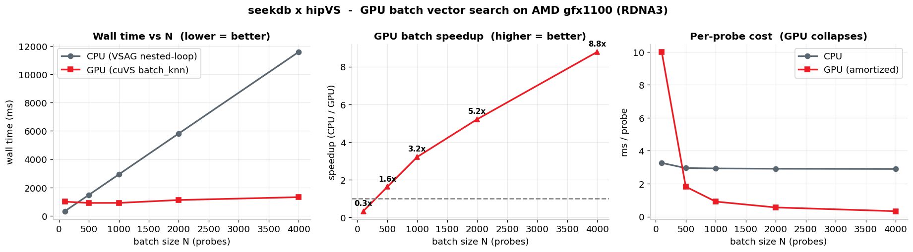

# seekdb × hipVS：AMD GPU 批量向量检索展示

需要手工填写课程 Notebook 时，请阅读[每个代码单元的完整内容及运行顺序](NOTEBOOK_CELLS_CN.md)。该说明也包含正确目录和旧版辅助库的识别方法。

**用户后续运行记录**：[用户提供的 JSON 及来源说明](results/user-run-20261031/README.md) · [批量耗时 CSV](results/user-run-20261031/summary.csv)。该次报告 N=4000 的批量查询加速比为 8.15×，CPU/GPU Recall@10 为 0.640/0.880；与下面独立执行的 9.88× 记录分开保存。

**2026-10-31 Notebook 状态修复**：已补齐启动单元自身需要的 `Path`/`time` 导入，增加数据准备和统计结果的前置检查；查询缺少探针、索引等待超时会明确报错。重新准备数据或测量失败后清除旧统计，避免保存的输出掩盖当前内核没有 `df` 的事实。

修复版已在 Radeon Cloud **全新内核执行 11/11 代码单元成功**，9 项辅助回归通过。[本轮已执行 Notebook](results/state-fix/executed.ipynb) · [完整结果](results/state-fix/summary.json) · [源码及运行文件哈希](results/state-fix/execution.json)。本轮 N=4000：CPU 11614.0 ms、GPU 1175.1 ms，9.88×；CPU/GPU 批量 Recall@10 为 0.640/0.876。下面的 8.78× 表格及根 results 输出保留为此前版本的历史记录，不与本轮混用。

交互运行请打开本目录的 **`seekdb_hipvs_batch_demo.ipynb`**，选择 **Restart Kernel and Run All Cells（重启内核并运行所有单元）**。须先完成第 3 节的启动及数据导入，再执行查询；显示着旧表格不代表重启后的内核中仍存在对应变量。不要在 `results` 子目录中执行已保存的 Notebook，那里仅用于查看记录。

按用户提供的课程 Notebook 整理，完整包含环境自检、工作原理、启动与数据准备、单查对照、批量提速、召回检查和总结记分牌七部分。图表与结论由本次运行数据生成，不固定展示原截图中的 12.7×。

[完整展示包](../seekdb-hipvs-batch-demo.zip)包含 Notebook、辅助代码、原始结果和回归测试，运行仍需下面说明的课程镜像依赖。

**运行依赖**：课程 `seekdb-hipvs` 镜像预装的 `/seekdb_workspace/bin/seekdb`、`libseekdb_cuvs_bridge.so`、hipVS/ROCm 和数据集。本目录提供 Notebook、运行管理、查询辅助和验证代码；没有声称重新实现镜像内部的 GPU C++ 算子。仓库另一个 HNSW 构建项目测量的是建索引时间，本演示测量的是查询，两者分别记录。

## 文件与运行记录

| 文件或目录 | 用途 |
| --- | --- |
| [seekdb_hipvs_batch_demo.ipynb](seekdb_hipvs_batch_demo.ipynb) | 交互运行的源 Notebook，配合本目录 `lib/` 使用 |
| [lib/](lib/) | 查询辅助代码、服务启动和进程管理 |
| [run_demo.py](run_demo.py) / [requirements.txt](requirements.txt) | 从头执行入口与 Python 依赖 |
| [NOTEBOOK_CELLS_CN.md](NOTEBOOK_CELLS_CN.md) | 全部 11 个代码单元及操作顺序 |
| [results/user-run-20261031/](results/user-run-20261031/) | 用户提供的 8.15× JSON，以及从该 JSON 导出的 CSV；尚无此次完整已执行 `.ipynb` |
| [results/state-fix/](results/state-fix/) | 修复版独立执行的 9.88× Notebook、JSON、CSV、图表与哈希记录 |
| [results/executed.ipynb](results/executed.ipynb) | 较早 8.78× 运行的已执行 Notebook，保留历史输出 |

完整展示包包含上面的源文件、辅助代码、三组已有记录和回归测试。8.15× 记录缺少此次完整已执行 Notebook，不能用 9.88× 或 8.78× 文件替代它。

## 较早真实运行记录：8.78×（2026-10-31）

| 探针数 N | CPU 毫秒 | GPU 毫秒 | 加速比 |
| ---: | ---: | ---: | ---: |
| 100 | 326.0 | 999.9 | 0.33 |
| 500 | 1474.2 | 909.3 | 1.62 |
| 1000 | 2924.4 | 912.2 | 3.21 |
| 2000 | 5816.8 | 1116.0 | 5.21 |
| 4000 | 11581.6 | 1318.6 | 8.78 |

单查 CPU/GPU：**8.54 / 12.67 ms**。CPU Recall@10 为 **0.640**；GPU 批量为 **0.884**，GPU 单查为 **0.882**。

GPU 单查与批量仅 **19/100** 个查询的 top-10 集合完全相同，因此没有保留参考文案里“结果完全一致”的承诺。近似检索结果与配置和路径有关，本次没有进一步归因。



[已执行 Notebook](results/executed.ipynb) · [原始 JSON](results/summary.json) · [CSV](results/summary.csv) · [源码/二进制/数据哈希](results/execution.json)

## 快速运行

推荐在 Radeon Cloud 的 seekdb-hipvs Notebook 镜像中运行。Linux x86-64，AMD GPU/ROCm，`mysql` 客户端；课程二进制及三个数据文件位于 `/seekdb_workspace`。本次测试为 gfx1100、ROCm 7.2.4、16 核 CPU 配额和 55 GiB 内存配额。

保留至少 35 GiB 可用磁盘，数据库目录须支持 `fallocate`。启动采用课程示例的 20 GiB 数据文件、最大 40 GiB、10 GiB 日志盘；不要使用不支持该调用的 NFS 目录。镜像已安装 Python 依赖；其他匹配环境可使用 `requirements.txt`。

```bash
cd notebooks/seekdb-hipvs-batch-demo
python run_demo.py
```

输出位于 `results/`：

- `executed.ipynb`：从头执行并保存图表的 Notebook。
- `summary.csv`、`summary.json`：批量耗时、吞吐、召回和结果检查。
- `seekdb_hipvs_speedup.png`：耗时、加速比及每探针成本三联图。
- `execution.json`：完成状态、时间和执行源码 SHA-256；失败也保存，退出状态非零。

在 JupyterLab 中，也可打开 `seekdb_hipvs_batch_demo.ipynb`，选择 Python 3，然后 **Run → Run All Cells**。新数据库位于本目录的 `run/obs1`；会重建该专用实例 `vec` 库中的演示表。若 2881 端口属于其他实例，启动明确报错，不自动结束它。

`results/executed.ipynb` 用于浏览已保存的结果；重新执行请使用根目录源 Notebook 或上述 CLI，保持工作目录和 `lib/`、`results/` 的相对位置一致。

结束本演示服务：

```bash
python lib/start_server.py "$PWD/run/obs1" --stop
```

模型服务的 Base URL/API Key 不参与这个演示。SSH 密钥只用于连接云实例。GPU 后端通过 SQL `lib=cuvs` 选择，不需要 GPU 选择环境变量；启动脚本自动设置镜像运行库搜索路径。

## 七部分展示

| 部分 | 实际内容 |
| --- | --- |
| 1. 环境自检 | GPU/架构、显存、ROCm、二进制、bridge 和动态链接情况 |
| 2. 工作原理 | `SQL → obvsag → CPU VSAG` 或 `C bridge → hipVS CAGRA → ROCm` |
| 3. 数据准备 | 同源 10,000 × 128 向量的 `t_cuvs` 与 `t_vsag`，M=16、ef_construction=200、ef_search=64 |
| 4. 单条查询 | 各预热两次，分别取五次最小端到端耗时；含 mysql 客户端与 SQL 调用开销 |
| 5. 批量提速 | N=100/500/1000/2000/4000，CPU lateral join 对照 GPU `batch_knn`，输出三联图 |
| 6. 召回与正确性 | 100 条查询对镜像真值计算 Recall@10；实测 GPU 单查与批量的一致数 |
| 7. 总结记分牌 | 展示本次单查、峰值加速、吞吐和召回，不把小批量 GPU 较慢的结果隐去 |

```sql
CREATE VECTOR INDEX i ON documents(embedding)
  WITH (distance=l2,type=hnsw,lib=cuvs,m=16,ef_construction=200,ef_search=64);
CALL dbms_vector.batch_knn('t_cuvs','probes_4000',10,'bk_out');
```

## 数据与结果口径

探针批次由相同的 100 条查询循环填充，4000 个探针不代表 4000 个独立查询。每个 N 在一次小批量预热后测量一次 CPU 和 GPU，不能把单次曲线当作多轮统计结论。

原始 helper 会丢弃计时 SQL 的错误状态；实跑时大批量 CPU 查询曾达到默认 10 秒超时。本版对 SQL 失败立即报错，将查询会话超时设为 600 秒，并在计时结束后校验每个批次恰好 N×10 行。检查不计入所记录的 SQL 时间，CPU 和 GPU 都保留相同的超时设置开销。

最终还核对每个查询返回十个不同结果、数据量完整、耗时有限且为正。GPU 单查/批量一致性以测量结果为准，不预设完全相等。当前参数下 CPU/GPU 召回不同，本演示不构成等召回调优后的性能比较。

课程介绍过滤、删除和非 L2 场景回退 CPU。本目录没有用 profiler 或额外 SQL 用例证明这些回退路由，因此不承诺这些场景已全部验收。这里也不以 `gfx1100` 单独证明显卡商业型号是 W7900。

## 来源及改动

- 原始七章内容和 Notebook 来自用户提供的 `seekdb_hipvs_batch_demo_executed.ipynb` 与粘贴材料；helper 原型来自课程镜像的 `seekdb_hipvs_notebook/lib/seekdb_demo.py`。
- 修改：可移植目录、失败即停、600 秒 SQL 超时、每批次行数校验、单查/批量实测对照、完整执行器和 JSON/CSV 输出。
- `lib/sdb.py` 从本仓库 `.github/script/seekdb/sdb.py` 原样复用，保留其进程归属校验；`start_server.py` 增加端口归属保护，不使用原课程脚本中的递归删除方式。
- 数据集、seekdb、hipVS/ROCm 二进制不加入本目录，使用课程镜像提供的版本。公开 Notebook 只显示 telemetry JSON 已解析，不打印完整运行标识。
- 镜像工作区附带的 Apache-2.0 许可文本保留为 `LICENSE.course`；新增包装代码遵循仓库许可，不将课程原型冒称为本次独立开发的 GPU 后端。
- 本目录是批量查询演示；本赛题的 HNSW 索引构建实现与验收见 [赛事提交说明](../../docs/gpu-hnsw-build/SUBMISSION.md)，查询结果不作为构建成绩。
